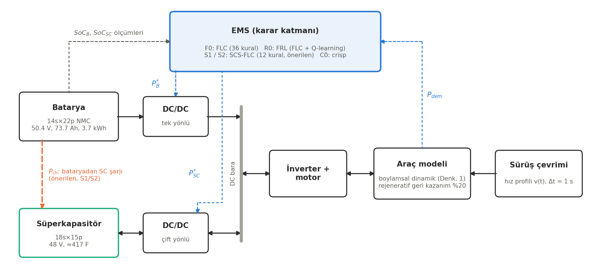
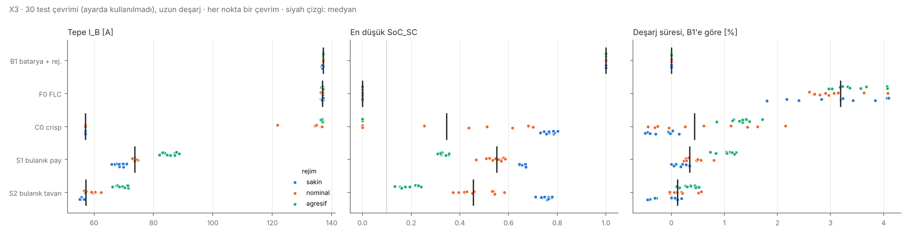

# Project Title (Proje Başlığı)

**Elektrikli İki Tekerlekli Araçlarda Batarya/Süperkapasitör Hibrit Enerji Depolama Sistemi için Bulanık Takviyeli Öğrenme Tabanlı Enerji Yönetimi: Yeniden Gerçekleştirme ve SoC-Duyarlı Bulanık Şarj Yasası ile Geliştirme**

Bulanık Mantık dersi dönem projesi. Projede bir referans makale incelendi, yöntemi Python'da yeniden gerçekleştirildi, sonuçları makaleyle karşılaştırıldı ve özgün bir bulanık mantık geliştirmesi önerilip deneysel olarak değerlendirildi.

- 📄 **Teknik rapor:** [`report/report.pdf`](report/report.pdf)
- 🎤 **Sunum:** [`presentation/`](presentation/)
- 🖥️ **Canlı demo:** [`demo/`](demo/) (`streamlit run demo/app.py`)

## Student Information (Öğrenci Bilgileri)

| | |
|---|---|
| Öğrenci | Esma Mutlu |
| Öğrenci No | 1306220051 |
| Bölüm | Bilgisayar Mühendisliği, İstanbul Üniversitesi-Cerrahpaşa |
| Ders | Bulanık Mantık |
| Dersin Yürütücüsü | Prof. Dr. Rüya Şamlı |

## Original Paper (Referans Makale)

N. Kumaresan and A. Rammohan, "Fuzzy reinforcement learning-based energy management strategy for the integration of hybrid energy storage system of electric vehicle," *Results in Engineering*, vol. 28, Art. no. 107875, 2025, doi: [10.1016/j.rineng.2025.107875](https://doi.org/10.1016/j.rineng.2025.107875).

Yazarların resmî kodu yayımlanmamıştır. Bu repodaki kodun tamamı proje kapsamında yazılmıştır. Hazır bir bulanık mantık ya da RL kütüphanesi kullanılmamıştır.

## Problem Description (Problem Tanımı)

Şehir içi sürüşte sık hızlanma ve frenleme, elektrikli scooterların bataryasında kısa süreli yüksek akım tepeleri oluşturur. Bu tepeler bataryayı ısıtır ve yaşlanmasını hızlandırır. Bir **hibrit enerji depolama sisteminde (HESS)** batarya enerji deposu olarak çalışır. Güç yoğunluğu yüksek **süperkapasitör (SC)** ise tepe güçleri ve rejeneratif frenleme enerjisini üstlenir. Problem, her saniye güç talebinin ne kadarının bataryadan, ne kadarının SC'den karşılanacağına karar veren **enerji yönetim stratejisinin (EMS)** tasarlanmasıdır.

## Method (Yöntem)

**Referans yöntem [1]:**
- 3 girdili, 36 kurallı bir **Mamdani FLC**. Girdiler $SoC_B$, $SoC_{SC}$ ve $P_{dem}$; çıktılar batarya ve SC güç katsayıları.
- FLC'nin kararını düzelten bir **tablo Q-learning** katmanı (FRL).

**Yeniden gerçekleştirme:**
- Araç, batarya ($R_{int}$ ve termal model) ve SC modelleri; DC/DC dönüştürücüler ve güvenlik katmanı.
- Tablo 5'teki 36 kuralın birebir uygulandığı FLC ve 5 tohumla eğitilen FRL.
- Makalede eksik bırakılan her parametre için gerekçeli bir varsayım alındı: [`docs/implementation_plan.md`](docs/implementation_plan.md).

**Önerilen geliştirme, SCS-FLC (supercapacitor-sustaining FLC):**
- Yeniden üretim, makalenin kural tabanının SC'yi uzun sürüşte ~1070 s içinde boşalttığını gösterdi.
- Bu yüzden 2 girdili ($P_{dem}$, $SoC_{SC}$), 12 kurallı yeni bir Mamdani denetleyici tasarlandı.
- Denetleyicinin yeni bir çıktısı var: bataryadan SC'ye şarj gücü $P_{ch}$.
- Ana varyant **S2**, bataryanın gücünü bir tavanda kırpar ve SC'yi $SoC_{SC}$ ile sürekli değişen **bulanık bir şarj yasasıyla** doldurur.
- Ayrıntılar: [`docs/contribution_proposal.md`](docs/contribution_proposal.md).

## Fuzzy System Architecture (Bulanık Sistem Mimarisi)



| | Referans FLC (F0) | Önerilen SCS-FLC (S2) |
|---|---|---|
| Çıkarım | Mamdani: min (VE), min (çıkarım), max (birleştirme), ağırlık merkezi | Aynı |
| Girdiler | $SoC_B$, $SoC_{SC}$ (Low/Medium/High), $P_{dem}$ (Low/Medium/High/Regeneration) | $SoC_{SC}$, $P_{dem}$ |
| Üyelik fonksiyonları | Yamuk, %50 örtüşen (Ruspini bölümlemesi) | Aynı (ölçekleri ayarlı) |
| Çıktılar | $C_B$, $C_{SC}$ (talebin yüzde payları) | $P_{cap}$ (batarya güç tavanı), $P_{ch}$ (SC şarj gücü) |
| Kural sayısı | 36 | 12 |
| Kod | [`src/hess/flc_ems.py`](src/hess/flc_ems.py) | [`src/hess/scs_flc.py`](src/hess/scs_flc.py) |

Bulanık çıkarım motoru: [`src/hess/fuzzy.py`](src/hess/fuzzy.py).

SCS-FLC kural tabanı ($C_{SC}$ (S1) / $P_{ch}$). S2'de $P_{ch}$ kuralları aynıdır, $P_{cap}$ ise $SoC_{SC}$ Low / Medium / High için Loose / Mid / Tight olur:

| $P_{dem}$ \ $SoC_{SC}$ | Low | Medium | High |
|---|:---:|:---:|:---:|
| Low | Z / **High** | Z / Medium | Z / Zero |
| Medium | Z / Low | VS / Zero | M / Zero |
| High | S / Zero | L / Zero | VL / Zero |
| Regeneration | Full / Zero | Full / Zero | Full / Zero |

## Dataset (Veri Seti)

Makaledeki gerçek sürüş kaydı paylaşılmadığı için **sentetik şehir içi sürüş çevrimleri** kullanıldı. Hazır bir veri seti yoktur, bütün veriler repodaki kodla üretilir.

- **Eğitim çevrimi:** [`data/synthetic_urban_900s.csv`](data/synthetic_urban_900s.csv), tohum 7.
  - Makalenin raporladığı altı istatistiğe uyar: 900 s, 12.4 km, ortalama 49.6 km/h, en yüksek 83 km/h, +2.7 / −2.6 m/s².
  - Üretici: `experiments/baseline/make_drive_cycle.py`.
- **Test çevrimleri (X3):** 30 çevrim, ayarda hiç kullanılmadı.
  - Tohum 101–110 × sakin / nominal / agresif rejim.
  - Çalışma sırasında [`src/hess/test_cycles.py`](src/hess/test_cycles.py) ile üretilir.

## Installation (Kurulum)

```bash
git clone https://github.com/Esmaa22/hess-fuzzy-energy-management.git
cd hess-fuzzy-energy-management
python3 -m venv .venv
source .venv/bin/activate        # Windows: .venv\Scripts\activate
pip install -r requirements.txt
```

## Requirements (Gereksinimler)

- Python ≥ 3.10 (Python 3.13 ile geliştirildi ve test edildi)
- Kütüphaneler ([`requirements.txt`](requirements.txt)):
  - `numpy>=2.1`, `scipy>=1.14`, `pandas>=2.2.3`, `matplotlib>=3.9`, `pyyaml>=6.0`
  - `pytest>=8.0`
  - `streamlit>=1.40` (yalnızca demo için)
- Yalnızca raporu yeniden derlemek için: `pandoc` ≥ 2.9 ve XeLaTeX (TeX Live).
- GPU gerekmez. Bütün deneyler CPU'da çalışır.

## How to Run (Çalıştırma)

Bütün komutlar **repo kökünden** çalıştırılır. Parametreler [`config/default.yaml`](config/default.yaml) dosyasındadır. Bütün rastgelelik tohumla sabitlenmiştir.

```bash
# 1. Testler (96 test, ~20 s)
pytest -q

# 2. Baseline: referans FLC ve FRL'nin yeniden üretimi
python experiments/baseline/train_frl.py          # FRL eğitimi, 5 tohum (~5 dk; Q tabloları repoda hazır)
python experiments/baseline/run_reproduction.py   # E1–E3, E6 (~15 s)
python experiments/baseline/run_e4_dcdc.py        # E4, DC/DC verim taraması (~1.5 dk)

# 3. Önerilen yöntem
python experiments/proposed/tune.py               # C0, S1, S2 eşit bütçeli ayar → config/tuned.yaml (~1 dk)
python experiments/proposed/run_main.py           # X1 ana karşılaştırma, X2 ablasyonlar (~1 dk)
python experiments/proposed/run_robustness.py     # X3 30 test çevrimi, X4 duyarlılık, X5 gürültü (~3.5 dk)

# 4. Canlı demo
streamlit run demo/app.py

# 5. Rapor (isteğe bağlı)
bash report/build.sh
```

Eğitilmiş Q tabloları (`results/models/`) ve ayarlı parametreler (`config/tuned.yaml`) repoda hazırdır. Bu yüzden 2. ve 3. adımlardaki deney betikleri eğitim ve ayar adımları atlanarak da doğrudan çalıştırılabilir. Bütün tablolar `results/tables/`, grafikler `results/figures/` altına yazılır.

## Reproduction Experiments (Yeniden Üretim Deneyleri)

| Deney | Açıklama | Betik |
|---|---|---|
| E1 | Sadece batarya / FLC / FRL, uzun deşarj (%100 → %20) | `run_reproduction.py` |
| E2, E3 | İlk çevrimde güç paylaşımı ve SC SoC seyri | `run_reproduction.py` |
| E4 | DC/DC verim taraması, $\eta_c$ = 0.91–1.00 (makale Şekil 14) | `run_e4_dcdc.py` |
| E5 | FRL öğrenme eğrisi, 5 tohum | `train_frl.py` |
| E6 | Rejenerasyonlu sadece-batarya (adil baseline B1) | `run_reproduction.py` |

| Ölçüt | Makale B0 / FLC / FRL | Bizim B0 / FLC / FRL |
|---|---|---|
| Tepe batarya akımı, uzun deşarj (A) | 132 / 102 / 97.9 | 137.1 / 136.2 / 132.9 ± 4.4 |
| Tepe batarya akımı, ilk çevrim (A) | – | 117.0 / 86.2 / 103.9 ± 3.9 |
| Deşarj süresi (s) | 6540 / 6950 / 6990 | 6755 / 7477 / 7466 ± 19 |

**Bulgular:**
- Sadece-batarya modeli makaleyle uyumludur (tepe +%3.9, süre +%3.3).
- FLC'nin tepe akım azalması SC dolu iken yeniden üretilmiştir (−%26.3, makale −%22.7). Uzun deşarjda ise SC boşaldığı için azalma kaybolur (−%0.7).
- FRL'nin FLC'ye üstünlüğü istatistiksel olarak yeniden üretilememiştir.
- Menzil kazancının yaklaşık üçte ikisi SC'den değil rejeneratif frenlemeden gelir.

## Proposed Extension (Önerilen Geliştirme)

| Kod | Yöntem |
|---|---|
| F0 / R0 | Referans FLC / FRL |
| C0 | Aynı fikrin keskin (crisp) eşiklerle uygulanışı: eşiğin üstünü SC'ye ver, düşük talepte SC'yi şarj et |
| S1 | SCS-FLC, birinci çıktı SC'nin talep payı ($C_{SC}$) |
| **S2** | **SCS-FLC, birinci çıktı batarya güç tavanı ($P_{cap}$) — ana katkı** |
| A1–A5 | Ablasyonlar: şarj yok, Tablo 5 + şarj, +$SoC_B$, sabit tavan, crisp şarj kuralı |

**Adil karşılaştırma:**
- C0, S1 ve S2 aynı bütçeyle ayarlandı: yöntem başına 24 değerlendirme, Latin hiperküp.
- Ayar yalnızca eğitim çevriminde yapıldı.
- Başarı ölçütleri (K1–K5) deneylerden önce tanımlandı.

| Deney | Açıklama |
|---|---|
| X1 | Bütün yöntemler, eğitim çevrimi, uzun deşarj |
| X2 | Ablasyonlar A1–A5 |
| X3 | 30 görülmemiş test çevrimi, eşleştirilmiş Wilcoxon testi |
| X4 | Parametre duyarlılığı: her parametre ±%10 ve ±%20 |
| X5 | Ölçüm gürültüsü: σ = 0.02 ve 0.05 |

## Experimental Results (Deney Sonuçları)

| Ölçüt | F0 (baseline) | C0 (crisp) | S1 | **S2** | S2 / F0 |
|---|---:|---:|---:|---:|---:|
| X1 tepe $I_B$ (A) | 136.2 | 57.1 | 73.2 | **60.8** | −%55.3 |
| X1 RMS $I_B$ (A) | 43.6 | 35.9 | 37.2 | 36.0 | −%17.3 |
| X1 sıcaklık artışı (°C) | 1.88 | 1.15 | 1.27 | 1.18 | −%37.6 |
| X1 deşarj süresi (s) | 7477 | 7308 | 7258 | 7255 | −%3.0 |
| X3 tepe $I_B$ ort. / en kötü (A) | 136.9 / 137.2 | 93.6 / 137.1 | 75.9 / 88.6 | **61.1 / 71.5** | −%55.4 / −%47.9 |
| X3 çöken çevrim (SC boşaldı) | 30 / 30 | 14 / 30 | 0 / 30 | **0 / 30** | – |
| X4 ±%20 bozulmada en büyük kötüleşme | – | +%137.6 | +%18.1 | **+%12.3** | – |
| Karar süresi (µs/adım, Python) | 163 | 0.2 | 117 | 84 | −%48.7 |



**Bulgular:**
- S2, görülmemiş 30 çevrimde hiç çökmedi. Ortalama tepe akımı F0'a göre %55, crisp kurala göre %35 düşük (Wilcoxon $p = 1.7 \times 10^{-6}$).
- Crisp kural 30 çevrimin 14'ünde çöktü.
- Ablasyonlar dayanıklılığın kaynağını gösterdi: $SoC_{SC}$ ile sürekli değişen **bulanık şarj yasası**. Crisp şarj kuralıyla (A5) S2 de 11/30 çevrimde çöker.
- **Olumsuz bulgu:** SoC'ye uyarlanan güç tavanının anlamlı bir katkısı yoktur (A4, $p = 0.17$).
- Bedel: F0'a göre ~%3 daha kısa deşarj süresi.

Bütün sayılar `results/tables/` altındaki CSV dosyalarından gelir. Tam tartışma raporun 8–9. bölümlerindedir.

## Limitations (Sınırlılıklar)

- Yalnızca benzetim yapıldı, donanım testi yok. Dönüştürücü ve motor verimleri sabit.
- Makalede verilmeyen parametreler (araç kütlesi, MF köşe noktaları, FRL eylem kümesi, termal model) tarafımızdan seçildi. Sıcaklık yalnızca göreli yorumlanmalıdır.
- Sürüş çevrimleri sentetik ve aynı üreteçten geliyor. Gerçek kayıtlar ve standart çevrimler (WMTC vb.) denenmedi.
- Batarya yaşlanması doğrudan modellenmedi. Tepe akım, RMS, $I^2t$ ve $\Delta T$ vekil göstergelerdir.
- SCS-FLC üzerine düzeltilmiş ödüllü bir Q-learning katmanı (K-FRL) zaman nedeniyle eklenmedi. FRL, X3'te koşturulmadı.

## References (Kaynaklar)

Literatür taraması, karşılaştırmalı tablo ve 23 kaynağın tam IEEE listesi: [`references/README.md`](references/README.md).

[1] N. Kumaresan and A. Rammohan, "Fuzzy reinforcement learning-based energy management strategy for the integration of hybrid energy storage system of electric vehicle," *Results Eng.*, vol. 28, Art. no. 107875, 2025, doi: 10.1016/j.rineng.2025.107875.

[2] L. A. Zadeh, "Fuzzy sets," *Inf. Control*, vol. 8, no. 3, pp. 338–353, 1965, doi: 10.1016/S0019-9958(65)90241-X.

[3] E. H. Mamdani and S. Assilian, "An experiment in linguistic synthesis with a fuzzy logic controller," *Int. J. Man-Mach. Stud.*, vol. 7, no. 1, pp. 1–13, 1975, doi: 10.1016/S0020-7373(75)80002-2.

[4] C. J. C. H. Watkins and P. Dayan, "Q-learning," *Mach. Learn.*, vol. 8, pp. 279–292, 1992, doi: 10.1007/BF00992698.

---

## Repository Structure (Repo Yapısı)

```
├── config/            default.yaml (bütün parametreler), tuned.yaml (ayarlı C0/S1/S2)
├── data/              eğitim sürüş çevrimi
├── demo/              Streamlit canlı demo ve gösterim senaryosu
├── docs/              makale analizi (CP1), uygulama planı (CP2), katkı önerisi (CP4–CP5)
├── experiments/
│   ├── baseline/      yeniden üretim betikleri (E1–E6)
│   └── proposed/      önerilen yöntem betikleri (X1–X5)
├── presentation/      sunum
├── references/        literatür taraması ve IEEE kaynakça
├── report/            teknik rapor (report.md → report.pdf)
├── results/
│   ├── figures/       grafikler
│   ├── models/        eğitilmiş FRL Q tabloları
│   └── tables/        sonuç tabloları (CSV)
├── src/hess/          kaynak kod (modeller, bulanık motor, EMS'ler, simülatör)
└── tests/             96 birim testi
```

## Generative AI Usage (Üretken Yapay Zekâ Kullanımı)

Projede kod geliştirme, hata ayıklama, literatür taraması ve dokümantasyon için Anthropic'in Claude modelinden yardım alınmıştır. Sonuçlar testlerle, deneylerin yeniden koşturulmasıyla ve kaynakların DOI üzerinden kontrolüyle doğrulanmıştır. Ayrıntılar raporun "Generative AI Usage Disclosure" bölümündedir.

## License (Lisans)

[MIT](LICENSE) © 2026 Esma Mutlu
